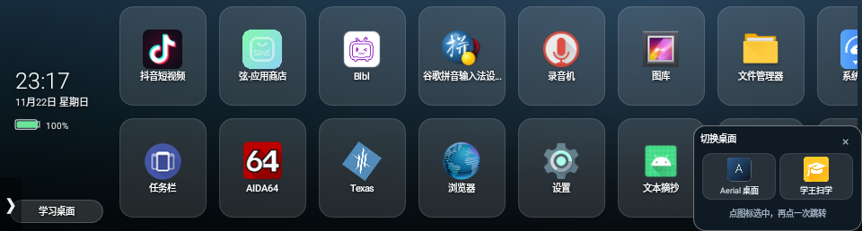
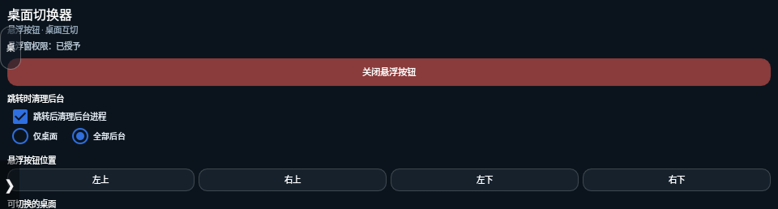
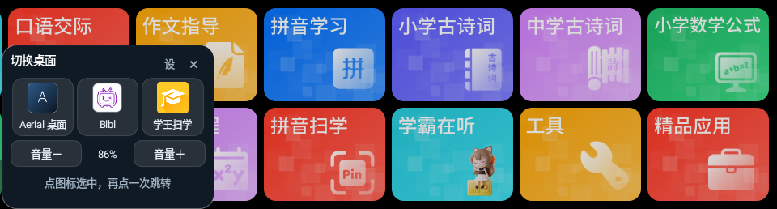

# pen-desktop-switcher

给低分辨率安卓点读笔（测试机：A20Pro，Android 6.0 / API 23，258×960，density 160）做的桌面切换器。贴边悬浮球 + 图标面板，点一下选桌面，再点一次跳转。



## 下载

- 官网：https://satellite18111.github.io/pen-desktop-switcher/
- Release：https://github.com/Satellite18111/pen-desktop-switcher/releases/latest
- 源码克隆：

```bash
git clone https://github.com/Satellite18111/pen-desktop-switcher.git
```

## 功能

- 贴边悬浮球，可拖动，松手按中线自动吸附左右边缘，位置持久化。
- 点球展开图标面板：点图标选中 → 提示「再点一次跳到「X」」→ 再点同一图标跳转；点面板外收起。
- 面板可整体拖动，位置记忆。
- 悬浮球与面板大小**分别**可调：80%–200%，10% 一档。
- 贴边手势条会自动避开悬浮球所在区域，球在哪都能优先点按和拖动。
- 面板自适应横竖屏：竖屏 2 列大图标，横屏单行大卡片；桌面多时可在面板内滚动。
- 面板底部音量行：`音量－ / 百分比 / 音量＋`，走 `STREAM_MUSIC`；横屏时并入标题栏。
- 跳转后可选择清理后台：关 / 仅桌面 / 全部后台（API 23 非 root 下为尽力清理，系统签名桌面杀不掉）。
- `＋ 添加桌面应用`：从已安装应用里选任意 Activity 加入可切换列表，长按条目可移除。
- 手势导航：左右边缘向内滑 = 返回，底部边缘向上滑 = 系统任务页面（需要开启无障碍服务）。
- 开机自启悬浮球；学王为默认 HOME 时也能用。

| 面板 | 设置 | 添加桌面 |
| --- | --- | --- |
|  |  |  |

## 构建

要求：JDK 17+、Android SDK Platform 36/37、Build-Tools 36.0.0。

```bash
./gradlew assembleRelease
```

产物在 `app/build/outputs/apk/release/app-release.apk`（未配置签名时为 `app-release-unsigned.apk`）。

默认构建**未签名**。要出可安装的 release 包，在工程根目录放 `keystore.properties`（已被 `.gitignore` 忽略）：

```properties
storeFile=keystore/release.keystore
storePassword=******
keyAlias=release
keyPassword=******
```

没有该文件时 Gradle 跳过签名配置，仍可正常编译。**不要把 keystore 和口令提交到仓库。**

## 安装与授权

```bash
adb push app-release.apk /data/local/tmp/switcher.apk
adb shell pm install -r /data/local/tmp/switcher.apk

# API 23 没有 pm grant，悬浮窗权限用 appops：
adb shell appops set aerial.pen.switcher SYSTEM_ALERT_WINDOW allow
```

安装后打开「桌面切换器」：

1. 授予悬浮窗权限（设置里找到「桌面切换器」开启，或使用上面的 appops 命令）；
2. 需要手势时勾选「开启手势导航」，再点「开启无障碍服务」；
3. 在系统无障碍列表里找到「桌面切换器」并开启。

## 手势说明

- 左右边缘向内滑 = 返回（`GLOBAL_ACTION_BACK`）。
- 底部边缘向上滑 = 最近任务（`GLOBAL_ACTION_RECENTS`）。
- 边缘触控条宽 9 px，贴着最边缘的点击会被它优先接收；面板展开时手势自动暂停。

## 配合桌面

- [PenDesk](https://github.com/Satellite18111/PenDesk)：仿 tvOS 风格的第三方桌面。
- 原厂学王桌面 `com.jxw.launcher` 也可作为跳转目标。

## 免责声明

本项目仅供个人学习、技术研究与自有设备个性化使用。下载、安装或使用即视为同意以下条款，完整版本见 [DISCLAIMER.md](DISCLAIMER.md)。

- **不得利用本项目进行任何非法活动。**
- **不得传播恶意软件或病毒。**
- **禁止在微信公众号平台宣传本项目**（为降低法律风险）。
- **禁止利用本项目牟利**；本项目无任何盈利行为，任何第三方收费、代装、广告或打赏均与本项目及作者无关。
- 本项目按「现状」提供，不附带任何担保；授权无障碍/悬浮窗、清理后台等操作的风险由使用者自行承担。

本仓库代码由 **豆老师** 编写，以 MIT License 开源。

## 许可证

MIT License，见 [LICENSE](LICENSE)。仓库内仅为 Kotlin 标准库与 Android Framework 调用。

## 作者声明
本项目及本页由豆包老师开发和撰写（除了这条），作者仅提供灵感。

